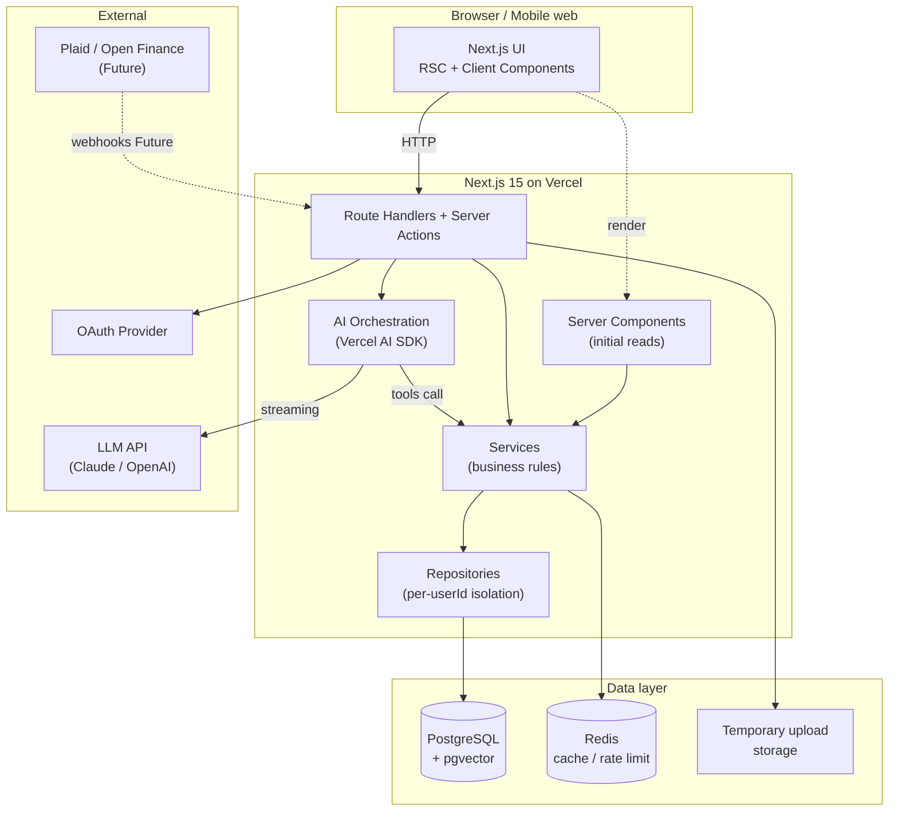
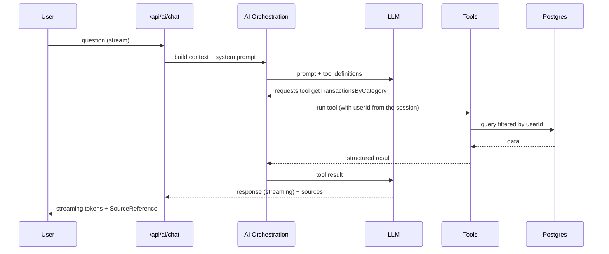
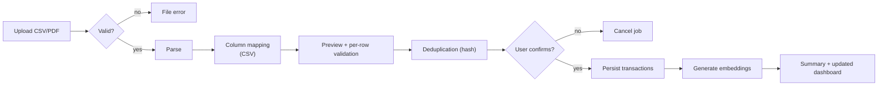

# FinSight AI — Technical Architecture

> Perspective: Tech Lead / Staff Engineer.
> Version: 0.1 · Status: living document

---

## 1. Technical architecture (overview)

FinSight AI is a modular monolith on Next.js 15 (App Router), deployed on Vercel, with Postgres + pgvector as the source of truth and Redis for cache/rate limit. The AI is orchestrated by the Vercel AI SDK with tool calling over the user's data. Separation is by **domain** (features) on the front and by **layers** (route handler → service → repository) on the back.

Principles:

- **Server-first:** sensitive data and logic stay on the server (RSC, route handlers, services). The client only receives what it needs to render.
- **Per-user isolation in every query** — the repository layer always receives and filters by `userId`.
- **The AI does not access the database directly** — only through tools that already enforce per-user isolation.
- **Graceful degradation:** an AI/Redis failure doesn't take down the core (transactions remain accessible).

Strategies per technology:

- **Server Components:** pages, initial reads (dashboard, lists) — fetch data on the server without exposing logic.
- **Client Components:** interactivity (forms, filters, chat, charts).
- **React Query:** cache and sync of client-side data that changes through interaction (transaction filters, refetch after mutation).
- **Zustand:** ephemeral/global UI state (open detail panel, active filters, chat draft) — not for server data.
- **Route Handlers:** REST API per domain (`/api/transactions`, `/api/import`, `/api/ai/chat`...).
- **Server Actions:** simple mutations coupled to forms (create transaction, save goal) where there's no need for a public endpoint.
- **Drizzle:** typed schema, versioned migrations, queries in the repository.
- **Redis:** dashboard aggregation cache, AI rate limit, import dedupe.
- **pgvector:** transaction embeddings for RAG in chat.
- **Vercel AI SDK:** streaming + tool calling; prompts and tools versioned in `ai/`.
- **Upload:** via route handler with validation; temporary storage; discard after processing.
- **Tests:** Vitest (unit/integration) + Playwright (E2E) + Testing Library (components).
- **Local:** Docker Compose (Postgres+pgvector, Redis); seed script; `.env.example`.
- **Deploy:** Vercel (preview per PR, production on merge to `main`); migrations in the pipeline.

---

## 2. Recommended folder structure

```txt
src/
  app/                      # routes (App Router): pages, layouts, route handlers
    (auth)/                 # auth/onboarding route group
    (app)/                  # authenticated group (dashboard, transactions, chat...)
    api/                    # route handlers per domain
  components/
    ui/                     # shadcn primitives (Button, Input, Dialog...)
    app/                    # generic layout/product (AppShell, PageHeader, MetricCard)
    charts/                 # chart wrappers (Recharts/D3)
    feedback/               # EmptyState, LoadingState, ErrorState, Toast
  features/                 # code per domain (UI + hooks + local types)
    auth/  onboarding/  dashboard/  transactions/  imports/
    categories/  ai-chat/  insights/  reports/  goals/  debts/
    settings/  integrations/
  server/
    actions/                # Server Actions
    api/                    # shared route handler helpers (responses, errors)
    services/               # business rules (pure, testable)
    repositories/           # data access (Drizzle), always with userId
    validators/             # Zod schemas per domain
  db/
    schema/                 # Drizzle tables
    migrations/             # generated migrations
    seed/                   # development seed
  ai/
    tools/                  # read tools (getMonthlySummary...) + controlled writes
    prompts/                # versioned system prompts
    rag/                    # context retrieval
    embeddings/             # embedding generation/storage
    guards/                 # sanitization, anti prompt-injection, limits
  lib/                      # utilities (currency/date formatters, etc.)
  hooks/                    # reusable hooks
  styles/                   # globals, tokens
  types/                    # shared types
  tests/                    # test setup, fixtures, mocks
docs/                       # this documentation
```

Responsibilities:

- `app/` — routing and composition; minimal logic.
- `features/` — everything for a domain together (components, hooks, types), making navigation easier.
- `server/services` — where business rules live (no direct I/O, receives repositories).
- `server/repositories` — the only layer that talks to the database; enforces per-user isolation.
- `ai/` — isolated AI orchestration, testable with mocks.
- `db/` — schema and migrations as the source of truth of the physical model.

---

## 3. Frontend strategy

- **Server Components:** pages and initial reads (dashboard, transaction list on first load, reports). No `useState`/effects.
- **Client Components:** forms, filters, chat, interactive charts, detail panel — marked with `"use client"`.
- **React Query:** for data that changes through client interaction (transaction pagination/filter, refetch after mutation, import status polling). Query keys per domain + parameters.
- **Zustand:** UI state (which transaction is selected in master-detail, shared active filters, chat draft). Never duplicate server data.
- **Hooks:** `features/x/hooks/useTransactions.ts` encapsulates React Query; UI doesn't call fetch directly.
- **Forms:** React Hook Form + Zod (same back-end schema via `validators/`).
- **Filters:** state in Zustand + synced to the URL (searchParams) for deep-linking and SSR.
- **Tables:** TanStack Table inside `DataTable`; virtualization when the list grows.
- **Loading/error/empty:** always via dedicated `feedback/` components; every query handles the 3 states.
- **Reusable layouts:** `AppShell` in the `(app)` group layout.
- **Generic vs product:** primitive in `components/ui`, layout in `components/app`, domain in `features/*/components`.

---

## 4. Design system / UI foundation

| Component                    | Where                   | Type     | Main props               | States                       | Tests            | Deps     |
| ---------------------------- | ----------------------- | -------- | ------------------------ | ---------------------------- | ---------------- | -------- |
| Button                       | `components/ui`         | generic  | variant, size, loading   | hover/focus/disabled/loading | unit             | cva      |
| Input                        | `components/ui`         | generic  | error, label             | focus/error/disabled         | unit             | —        |
| Select                       | `components/ui`         | generic  | options, value           | open/disabled                | unit             | radix    |
| Dialog                       | `components/ui`         | generic  | open, onOpenChange       | open/closed (focus trap)     | unit a11y        | radix    |
| Dropdown                     | `components/ui`         | generic  | items                    | open                         | —                | radix    |
| Card                         | `components/app`        | generic  | —                        | —                            | —                | —        |
| Table/DataTable              | `components/app`        | generic  | columns, data            | loading/empty                | unit             | tanstack |
| EmptyState                   | `components/feedback`   | generic  | title, action            | —                            | —                | —        |
| LoadingState                 | `components/feedback`   | generic  | variant (skeleton)       | —                            | —                | —        |
| ErrorState                   | `components/feedback`   | generic  | onRetry                  | —                            | —                | —        |
| ChartCard                    | `components/charts`     | generic  | title, data              | loading/empty                | —                | recharts |
| MetricCard                   | `components/app`        | product  | label, value, trend      | —                            | unit             | —        |
| PageHeader                   | `components/app`        | product  | title, subtitle, actions | —                            | —                | —        |
| Sidebar / Topbar             | `components/app`        | product  | items, user              | active                       | —                | —        |
| DateRangePicker              | `components/app`        | generic  | range, onChange          | —                            | unit             | —        |
| FileUploader                 | `features/imports`      | product  | accept, maxSize, onFiles | idle/uploading/error         | unit             | —        |
| TransactionForm              | `features/transactions` | product  | initial, onSubmit        | submitting/error             | unit+integration | RHF+Zod  |
| CategoryBadge                | `features/categories`   | product  | category                 | —                            | —                | —        |
| TransactionAmount            | `components/app`        | product  | amount, currency         | —                            | unit             | —        |
| AIChatMessage                | `features/ai-chat`      | product  | role, content, sources   | streaming                    | unit             | —        |
| InsightCard                  | `features/insights`     | product  | insight, onAction        | —                            | unit             | —        |
| DebtCard / DebtStrategyPanel | `features/debts`        | product  | debt / strategy          | —                            | unit             | —        |

---

## 5. Backend and API

- **Route Handlers:** one file per resource in `app/api/<domain>/route.ts`; logic delegated to services.
- **Validation:** every input goes through a Zod schema (`validators/`); reject early with 422.
- **Auth/authorization:** middleware extracts the session; each handler obtains `userId` and passes it to services/repos. No query without `userId`.
- **Responses:** consistent envelope `{ data }` or `{ error: { code, message, details? } }`.
- **Errors:** a domain error class mapped to an HTTP status; never leak stack/PII.
- **Services/Repositories:** service = rules; repository = data. Handlers stay thin.
- **No heavy logic in the route:** parsing/computation in services; the route only orchestrates.

Initial endpoints:

```txt
POST   /api/auth/session            # via Auth.js
GET    /api/onboarding              # onboarding state
POST   /api/onboarding              # saves preferences
GET    /api/dashboard               # period aggregations
GET    /api/transactions            # list (filters, pagination)
POST   /api/transactions            # create manual
PATCH  /api/transactions/:id        # edit / recategorize
DELETE /api/transactions/:id        # soft delete
GET    /api/categories              # list
POST   /api/categories              # create
GET    /api/categories/summary      # month total + budget usage (?month=YYYY-MM)
PATCH  /api/categories/:id          # edit name, color, icon, budget (kind is immutable)
DELETE /api/categories/:id          # move transactions to "Others" and remove
POST   /api/imports                 # create job (upload)
GET    /api/imports/:id             # status / preview
POST   /api/imports/:id/confirm     # confirm persistence
POST   /api/ai/chat                 # streaming + tool calling
GET    /api/insights                # list
POST   /api/insights/:id/action     # apply/ignore/useful
GET    /api/reports                 # generate report
GET    /api/goals  POST /api/goals  PATCH/DELETE /api/goals/:id
GET    /api/debts  POST /api/debts  PATCH/DELETE /api/debts/:id
GET    /api/settings  PATCH /api/settings
POST   /api/settings/export         # export data (JSON, records an audit_log)
POST   /api/settings/password       # change password (only credential accounts)
DELETE /api/settings/account        # delete account (hard delete + audit_log)
GET    /api/accounts  POST /api/accounts
DELETE /api/accounts/:id            # soft delete; 409 if there are still entries
```

Implementation notes (Settings / My account):

- `POST /api/settings/password`, `POST /api/settings/export` and
  `DELETE /api/settings/account` are rate limited via Redis
  (`src/server/api/rate-limit.ts`). The helper **fails open** if Redis is
  unavailable: the request proceeds (authentication is still required) instead of
  locking the user out of their own account.
- The export is a `POST`, not a `GET`, on purpose: a `GET` of personal data would
  end up in browser history, proxy logs and a shareable link.
- `Risk` — the session is a JWT: after account deletion the cookie stays
  cryptographically valid until it expires. The data no longer exists and every
  query filters by `userId`, but the client forces a logout (`POST /logout`) right
  after.

---

## 6. Database (Drizzle + PostgreSQL)

Cross-cutting strategies:

- **Per-user multi-tenancy:** every domain table has `user_id` (FK, indexed). No RLS in the MVP, but the repository enforces the filter; `Decision Needed` — enable Postgres RLS in the hardening phase as defense in depth.
- **Auditing:** append-only `audit_logs` for sensitive actions.
- **Soft delete:** `deleted_at` on domain entities; hard delete only on account deletion.
- **Embeddings:** a `vector` column (pgvector) in `ai_embeddings` with an HNSW index.
- **Imports:** `import_jobs` + `import_rows` preserve the raw data for auditing/rollback.
- **AI:** `ai_conversations`/`ai_messages` keep history; tool messages recorded.

Tables (summary of key fields):

```txt
users(id, email, oauth_provider, created_at)
user_profiles(user_id PK/FK, currency, primary_goal, closing_day, ai_consent_at,
              onboarding_completed_at, phone?, cpf?, ai_auto_categorize,
              ai_proactive_insights)
accounts(id, user_id, name, type, institution, created_at, deleted_at)
categories(id, user_id, name, color, kind[income|expense], icon?, budget?, parent_id?)
transactions(id, user_id, account_id, category_id?, amount, currency, kind,
             description, occurred_at, origin[manual|import|recurring|integration],
             recurring_rule_id?, dedupe_hash, created_at, deleted_at)
tags(id, user_id, name)
transaction_tags(transaction_id, tag_id)            # composite PK
import_jobs(id, user_id, file_id, status, total_rows, error_count, created_at)
import_rows(id, job_id, raw, parsed, status, error?, dedupe_hash)
uploaded_files(id, user_id, kind[csv|pdf], size, checksum, created_at, purged_at?)
ai_conversations(id, user_id, title, created_at)
ai_messages(id, conversation_id, role[user|assistant|tool], content,
            tool_name?, tokens?, created_at)
ai_insights(id, user_id, type, severity[info|warning|risk], title, body,
            status[new|applied|dismissed|useful], created_at)
ai_embeddings(id, user_id, transaction_id?, content, embedding vector(1536), created_at)
financial_goals(id, user_id, name, target_amount, current_amount, due_date?,
                status[active|completed|late], created_at, deleted_at)
debts(id, user_id, name, institution, principal, balance, monthly_rate,
      installment_amount, remaining_installments, created_at, deleted_at)
integration_connections(id, user_id, provider, status, access_token_enc,
                        refresh_token_enc, created_at)            # Future
webhook_events(id, connection_id, type, payload, processed_at?)  # Future
audit_logs(id, user_id, action, target, metadata, created_at)    # append-only
notification_preferences(user_id PK/FK, spend_alerts, installment_reminders,
                         weekly_summary)
```

Conscious deviations from the original design:

- `notification_preferences` does **not** have `anomaly_alerts`: nothing in the
  product controls this preference today, and a dead column is worse than a
  missing one. It comes in when the screen that uses it exists.
- The two AI flags (`ai_auto_categorize`, `ai_proactive_insights`) live in
  `user_profiles`, next to `ai_consent_at`, not in
  `notification_preferences`: they only make sense when consent exists.
- `cpf` is `varchar(11)` (digits only, with a `CHECK`) and **never leaves the
  server in the clear** — the API returns only a masked version
  (`src/server/services/settings/mask.ts`). `Risk` — it's sensitive PII with no
  defined purpose in the MVP; kept by a product decision.

Main indexes/constraints: `transactions(user_id, occurred_at)`, `transactions(dedupe_hash)` unique per account, `ai_embeddings` HNSW on `embedding`, FKs with `on delete cascade` in the account-deletion flow.

---

## 7. AI and RAG

- **Embeddings:** when importing/creating a transaction, generate an embedding of a textual representation ("2026-05-31 · Mercado Extra · Food · -312"), store it in `ai_embeddings` with `user_id`.
- **Storage:** pgvector, HNSW index, similarity search filtered by `user_id`.
- **Context retrieval (RAG):** for semantic questions ("that big purchase at the mall"), retrieve the top-k relevant transactions of the user and inject them into the context.
- **Tool calling:** the model decides which tools to call; tools run structured queries (more reliable than RAG for numbers). RAG complements, tools dominate.
- **Tools (read):** `getMonthlySummary`, `getTransactionsByCategory`, `getSpendingTrends`, `getRecurringExpenses`, `getBudgetRisks`, `getGoalProgress`, `getIncomeVsExpense`, `getTopMerchants`, `getUnusualSpending`, `getAvailableReports`, `getDebtOverview`.
- **Tools (controlled write):** `createInsight`, `categorizeTransaction` — require user confirmation before applying.
- **Data protection:** every tool receives `userId` from the session context (never from the prompt) and filters by it. The model never receives credentials nor accesses the database directly.
- **Safe responses:** the system prompt instructs a non-judgmental tone, disclaimers, and forbids making up numbers (only report what the tools return).
- **Cost:** rate limit per user; cache of responses to identical questions within the period; Haiku for cheap tasks (categorization), a larger model for chat. `Risk`
- **Streaming:** via the Vercel AI SDK (`streamText`/`streamUI`).
- **Recording:** conversations and messages in `ai_*`; tokens counted for a cost metric.
- **Tool tests:** unit with a test database/fixtures; chat tests with a mocked model.
- **Prompt injection:** `ai/guards` sanitizes content coming from user data (descriptions, PDFs); instructions and data are clearly separated; tools have a restricted scope and never run destructive actions without confirmation. `Risk`
- **AI scope:** limited to the user's own finances; refuses out-of-scope requests.
- **System prompts:** versioned in `ai/prompts`, testable and reviewable.

---

## 8. PDF/CSV ingestion

- **Upload:** the route handler receives the file; validates type (csv/pdf) and size (a limit, e.g. 10MB).
- **CSV:** parsing with a robust library; column mapping by the user (date, amount, description); format normalization (decimal, date).
- **PDF (`Should Have`):** text extraction + heuristics/AI per bank layout; quality varies → mandatory preview. `Risk`
- **Preview:** `ImportPreviewTable` with per-row validation; invalid rows flagged without blocking valid ones.
- **Deduplication:** `dedupe_hash` = hash(date+amount+description+account); duplicates flagged and not inserted.
- **Confirmation:** persistence only after the user confirms; a database transaction for atomicity.
- **Persistence:** inserts transactions + generates embeddings (async/queue as it grows).
- **Error/rollback:** failure halfway → job marked as failed, with no orphan transactions.
- **Security:** no PII in logs; file discarded (`purged_at`) after processing per policy.
- **Logs/tests:** auditable job; tests with CSV fixtures from various banks.

---

## 9. Security and privacy

- **Authentication:** Auth.js (OAuth + JWT), secure sessions (httpOnly, sameSite).
- **Authorization:** `userId` from the session in every operation; don't trust IDs coming from the client.
- **Isolation:** repository filters by `userId`; `Decision Needed` Postgres RLS in hardening.
- **Rate limit:** Redis (per user/IP) on sensitive and AI endpoints.
- **Encryption:** integration tokens encrypted at rest (`Future`); TLS in transit (Vercel).
- **Validation/sanitization:** Zod on every input; content sanitization for AI.
- **Logs:** structured, without financial data/PII.
- **Prompt injection / ingestion:** dedicated guards; file limits; tool scope.
- **Permissions:** resource ownership check on each access.
- **LGPD/GDPR:** explicit consent; export data; delete account (hard delete); auditing.
- **Session security:** rotation/expiration; CSRF for form mutations where applicable.

---

## 10. Observability

- **Sentry:** front and back errors, releases linked to the deploy.
- **OpenTelemetry:** distributed tracing (request → service → repo → db / AI).
- **Structured logs:** JSON, with `requestId`/`userId` (hashed), no PII.
- **API metrics:** latency, error rate per endpoint.
- **AI metrics:** tokens, cost per user, latency, negative-feedback rate.
- **Tracing:** spans for tool calls and import parsing.
- **Import/webhooks:** per-row error counters; webhook failures (`Future`).
- **Alerts:** errors above threshold, AI cost above budget, migration failure.

---

## 11. Tests

Order of what to test first: service business rules (most value, least cost), then endpoints and critical flows, then E2E of the main paths.

- **Vitest (unit):** services (dashboard computation, dedupe, debt strategy), validators, formatters.
- **Vitest (integration):** route handlers + repositories against a test database.
- **Testing Library:** design system components and forms.
- **Playwright (E2E):** onboarding → create transaction → see dashboard; import CSV → confirm; ask the AI (with a mocked model).
- **API tests:** response contracts and errors.
- **Business rules:** per-user isolation (try to access another's data → denied).
- **Upload:** valid/invalid CSV fixtures; sample PDFs.
- **AI:** tools with fixtures; chat with a mocked model (no cost/flakiness).
- **A11y:** axe on the key components and pages.

---

## 12. CI/CD (GitHub Actions)

```yaml
jobs:
  ci:
    steps:
      - checkout
      - setup-node (cache npm)
      - install (npm install --frozen-lockfile)
      - verify-envs (checks required variables)
      - lint (eslint)
      - typecheck (tsc --noEmit)
      - unit (vitest run)
      - drizzle-check (migrations consistent with schema)
      - build (next build)
      - e2e (playwright, in a service with Postgres+Redis)
      - deploy-preview (Vercel, on PR)
      - sentry-release (on main)
```

- Dependency and build cache.
- Preview deploy per PR; production on merge to `main`.
- Migrations applied in the deploy pipeline.

---

## 13. Open source documentation

Files:

- `README.md` — pitch, screenshots, stack, setup, roadmap status.
- `CONTRIBUTING.md` — how to run, standards, PR flow.
- `CODE_OF_CONDUCT.md` — Contributor Covenant.
- `SECURITY.md` — how to report a vulnerability.
- `LICENSE` — `Decision Needed` (MIT recommended for a portfolio).
- `.env.example` — all variables.
- `docs/product.md`, `docs/design-system.md`, `docs/architecture.md` (this one), `docs/api.md`, `docs/database.md`, `docs/ai.md`, `docs/roadmap.md`, `docs/testing.md`, `docs/observability.md`.

---

## Appendix A — Architecture diagram (high level)



## Appendix B — Flow of a chat question (sequence)



## Appendix C — Statement ingestion flow


